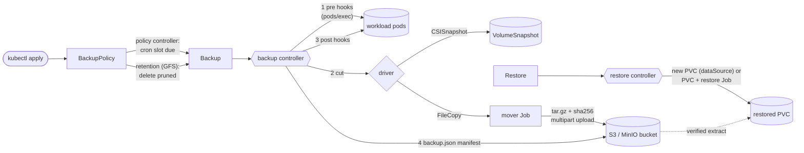

# keeper

A Kubernetes operator for **scheduled, application-consistent backups of
PVC-backed workloads**. It is built in the kubebuilder style on
controller-runtime v0.25 and Kubernetes 1.37 APIs.

You declare a `BackupPolicy`: a cron schedule, a grandfather-father-son
retention policy, a snapshot driver, pre/post hooks and an S3-compatible
bucket. keeper creates `Backup` objects on schedule. For each one it quiesces
the application through `exec` hooks, cuts a point-in-time copy with a CSI
VolumeSnapshot or a file-level mover Job, resumes the application, records
everything in status, conditions and events, and prunes old backups. A
`Restore` turns any completed Backup back into new PersistentVolumeClaims.

> Status: this is a portfolio project. It has not been used in production. The
> data path, the controllers and the API are exercised against a real
> kube-apiserver (envtest), a simulated kubelet/snapshot controller, and a real
> MinIO server. It has never run against a real cluster. See [Limitations](#limitations).

**Who it's for:** platform teams running stateful workloads (Postgres, Redis,
anything on a PVC) who want declarative backups with real consistency hooks
and a retention policy they can reason about. It's also a readable reference
operator for finalizers, CEL validation, idempotent state machines and envtest
testing.

## Features

- **Three CRDs.** `BackupPolicy` (schedule, retention, template), `Backup` (one point-in-time copy, immutable spec) and `Restore` (into new claims, never overwriting existing ones).
- **Cron scheduling in any IANA time zone**, with CronJob semantics: `Forbid`/`Allow` concurrency, `startingDeadlineSeconds`, `suspend`, bounded missed-slot catch-up, and deterministic Backup names so creation is idempotent.
- **Application-consistent hooks.** Pre/post `exec` commands are run in pods chosen by label selector, each with its own timeout and a `Fail`/`Continue` policy. Post hooks always run once pre hooks have run, so the application is never left frozen.
- **Pluggable snapshot drivers:**
  - `CSISnapshot`: one VolumeSnapshot per claim. Post hooks run at the cut (`creationTime`), not at `readyToUse`. Restore provisions from `dataSource`.
  - `FileCopy`: a hardened mover Job per claim streams a gzip'd tar through SHA-256 into an S3 multipart upload. Restores verify the checksum before data appears, and the extractor refuses traversal and symlink attacks.
- **S3-compatible storage behind an interface.** There's an in-memory store, a minio-go client (any S3/MinIO endpoint, SigV4, multipart), and a key layout with self-describing JSON manifests.
- **GFS retention** (`keepLast/Hourly/Daily/Weekly/Monthly/Yearly`, restic semantics) in the policy's time zone. Pinned backups are never pruned, failed-backup history is capped, and `retained-by` annotations show why each survivor survived.
- **Kubernetes-native.** Status conditions (`Ready`, `PreHooksSucceeded`, `SnapshotTaken`, `PostHooksSucceeded`, `DataStored`, `ScheduleValid`), `events.k8s.io` events, finalizers that delete stored data (or retain it), Prometheus metrics, and leader election.
- **CEL validation** for cross-field rules: exactly one volume source, driver blocks matching the driver type, `http(s)` endpoints, relative prefixes, at least one retention rule, 5-field cron with no `TZ=`, immutability.

## Architecture



Each reconcile performs one step of the Backup state machine
(`Pending → PreHooks → Snapshotting → PostHooks → Finalizing → Completed | Failed`)
and persists it. Reconcilers read their own object from the API server rather
than the cache, and write status with optimistic locking, so no step can
repeat because of a stale cached object. Driver calls are level-triggered and
idempotent. [docs/ARCHITECTURE.md](docs/ARCHITECTURE.md) has the state
machines, the crash-safety table, the algorithms and their complexity.

```
api/v1alpha1/          CRD types + CEL rules
internal/controller/   BackupPolicy, Backup, Restore reconcilers (+ envtest suite)
internal/snapshot/     Driver interface, CSI and FileCopy drivers
internal/retention/    GFS engine (pure, property-tested)
internal/schedule/     time-zone aware cron, bounded missed-slot search
internal/hooks/        pod selection, error policies, WebSocket/SPDY exec
internal/storage/      ObjectStore: memory, S3 (minio-go), layout, conformance suite
internal/mover/        streaming archive/extract with SHA-256 (fuzzed)
internal/simcluster/   test/demo only: simulated kubelet, provisioner, snapshot controller
cmd/keeper/            manager | mover | retention subcommands
cmd/keeper-demo/       offline end-to-end demo
config/                CRDs, RBAC, manager, samples (kustomize)
```

## Quickstart

Requirements: Go 1.27, golangci-lint v2, and network access on the first run
(Go modules plus the envtest kube-apiserver/etcd binaries, which are cached
after that).

```sh
make check   # gofmt, generated-code drift, go vet, golangci-lint, race tests incl. envtest, coverage ≥ 80%
make demo    # offline end-to-end demo (real API server, simulated kubelet, in-memory bucket)
make integration   # storage conformance + mover round trip against real MinIO (Docker; skips without it)
```

Deploying to a cluster (untested on a real cluster, see Limitations):

```sh
make docker-build IMG=registry.example/keeper:0.1.0   # push it, then set the image in config/manager
kubectl apply -k config/default                        # CRDs, RBAC, 2-replica leader-elected manager
kubectl apply -f config/samples/00-storage-secret.yaml # fill in real credentials first
kubectl apply -f config/samples/backuppolicy-postgres-filecopy.yaml
kubectl get bp,bk,rs -n shop
```

A policy, abridged from `config/samples/backuppolicy-postgres-filecopy.yaml`:

```yaml
apiVersion: backup.keeper.dev/v1alpha1
kind: BackupPolicy
metadata: {name: postgres, namespace: shop}
spec:
  schedule: "0 */6 * * *"
  timeZone: Asia/Kolkata
  retention: {keepLast: 4, keepDaily: 7, keepWeekly: 4, keepMonthly: 12}
  template:
    spec:
      source: {pvcSelector: {matchLabels: {app: postgres}}}
      driver: {type: FileCopy}
      storage:
        endpoint: https://minio.backup.svc.cluster.local:9000
        bucket: cluster-backups
        prefix: prod
        credentialsSecretRef: {name: backup-s3}
      hooks:
        pre:
          - {name: checkpoint, podSelector: {matchLabels: {app: postgres}}, command: [psql, -U, postgres, -c, CHECKPOINT]}
          - {name: freeze, podSelector: {matchLabels: {app: postgres}}, command: [fsfreeze, --freeze, /var/lib/postgresql/data]}
        post:
          - {name: thaw, podSelector: {matchLabels: {app: postgres}}, command: [fsfreeze, --unfreeze, /var/lib/postgresql/data]}
```

To preview a retention policy before you apply it:

```sh
$ printf '2026-03-01T02:00:00Z\n2026-03-02T02:00:00Z\n2026-03-03T02:00:00Z\n2026-03-03T14:00:00Z\n' \
    | go run ./cmd/keeper retention --keep-last=1 --keep-daily=2
TIME                  VERDICT  KEPT BY
2026-03-03T14:00:00Z  keep     last,daily
2026-03-03T02:00:00Z  prune
2026-03-02T02:00:00Z  keep     daily
2026-03-01T02:00:00Z  prune
2 kept, 2 pruned
```

## Demo

`make demo` starts a real kube-apiserver and etcd (envtest), installs the CRDs,
and runs the operator exactly as the binary wires it. Hooks go to a recording
fake executor, mover Jobs and VolumeSnapshots are carried out by
`internal/simcluster` against local directories, and the bucket is in memory.
A fake clock then fast-forwards through 60 days of 6-hourly slots. This is the
output of a real run (Apple M1 Pro):

```text
== 1. Start a real API server (envtest) with the keeper CRDs =============
kube-apiserver v1.37.0 up; CRDs: backuppolicies, backups, restores (+ VolumeSnapshot CRDs)

== 2. CRD validation (CEL) rejects bad specs at admission ================
  absolute storage prefix            -> rejected: prefix must be relative and must not contain '..'
  both pvcNames and pvcSelector      -> rejected: exactly one of pvcNames or pvcSelector must be set
  retention that keeps nothing       -> rejected: retention must keep at least one backup
  time zone smuggled into the cron   -> rejected: schedule must have exactly 5 fields or be an @descriptor

== 3. A Postgres workload and a 6-hourly BackupPolicy with hooks =========
policy shop/pg: schedule "0 */6 * * *" tz=UTC, keepLast=4 keepDaily=7 keepWeekly=4 keepMonthly=3, driver FileCopy

== 4. Fast-forward 60 days of schedule slots (fake clock) ================
  day   7 (2026-10-31):  28 backups taken,  9 retained,  19 pruned, store  27 objects 55.4KiB
  day  14 (2026-11-07):  56 backups taken, 11 retained,  45 pruned, store  33 objects 116.4KiB
  day  21 (2026-11-14):  84 backups taken, 12 retained,  72 pruned, store  36 objects 174.1KiB
  day  28 (2026-11-21): 112 backups taken, 12 retained, 100 pruned, store  36 objects 234.0KiB
  day  35 (2026-11-28): 140 backups taken, 12 retained, 128 pruned, store  36 objects 295.0KiB
  day  42 (2026-12-05): 168 backups taken, 12 retained, 156 pruned, store  36 objects 355.5KiB
  day  49 (2026-12-12): 196 backups taken, 13 retained, 183 pruned, store  39 objects 447.2KiB
  day  56 (2026-12-19): 224 backups taken, 13 retained, 211 pruned, store  39 objects 503.7KiB
  day  60 (2026-12-23): 240 backups taken, 13 retained, 227 pruned, store  39 objects 542.0KiB
240 backups ran in 33.5s of wall time
hook executions per backup (first backup): "postgres-0: psql -c CHECKPOINT", "postgres-0: fsfreeze --freeze /var/lib/postgresql", "postgres-0: fsfreeze --unfreeze /var/lib/postgresql"

== 5. What retention kept (newest first) =================================
BACKUP           SNAPSHOT (UTC)    WEEKDAY  ARCHIVE  RETAINED BY
pg-202612230000  2026-12-23 00:00  Wed      47.0KiB  last,daily,weekly,monthly
pg-202612221800  2026-12-22 18:00  Tue      46.8KiB  last,daily
pg-202612221200  2026-12-22 12:00  Tue      46.7KiB  last
pg-202612220600  2026-12-22 06:00  Tue      46.4KiB  last
pg-202612211800  2026-12-21 18:00  Mon      46.1KiB  daily
pg-202612201800  2026-12-20 18:00  Sun      45.4KiB  daily,weekly
pg-202612191800  2026-12-19 18:00  Sat      44.6KiB  daily
pg-202612181800  2026-12-18 18:00  Fri      43.7KiB  daily
pg-202612171800  2026-12-17 18:00  Thu      43.1KiB  daily
pg-202612131800  2026-12-13 18:00  Sun      40.0KiB  weekly
pg-202612061800  2026-12-06 18:00  Sun      34.8KiB  weekly
pg-202611301800  2026-11-30 18:00  Mon      30.3KiB  monthly
pg-202610311800  2026-10-31 18:00  Sat      7.0KiB   monthly
kept 13 of 240 (bound keepLast+keepDaily+keepWeekly+keepMonthly = 18); policy status: kept=13 prunedTotal=227 next=2026-12-23T06:00:00Z
survivors identical to retention.Apply over the same snapshot times: true
object store: 39 objects, 542.0KiB (only retained backups remain)

== 6. Restore the oldest retained backup and verify it bit-for-bit =======
restore pg-restore from pg-202610311800: phase=Completed target=restored-pg-data job=pg-restore-pg-data-restore
fingerprint at backup time aee31a072e5e279f | restored aee31a072e5e279f | live volume now e33cfd845757c938
restored data matches the point-in-time copy: true

== 7. A failing pre hook: no copy is taken and the app is thawed =========
phase=Failed reason=PreHookFailed
message: pre hook "freeze": pod postgres-0: hooks: command exited non-zero (code 1): fsfreeze: /var/lib/postgresql: Operation not supported
  hook pre   checkpoint pod=postgres-0 exit=0 ok=true
  hook pre   freeze     pod=postgres-0 exit=1 ok=false
  hook post  thaw       pod=postgres-0 exit=0 ok=true

== 8. CSI VolumeSnapshot driver: snapshot, then restore via dataSource ===
backup pg-snap: phase=Completed snapshot=pg-snap-pg-data restoreSize=20.0GiB manifest=prod/backups/shop/pg-snap/backup.json
restored claim snap-pg-data dataSource=VolumeSnapshot/pg-snap-pg-data; content matches snapshot: true

== 9. Deleting a Backup removes its data (finalizer) =====================
deleted pg-202612230000: store objects 40 -> 37

== 10. Events and metrics recorded by the operator =======================
  event Normal/Completed                 x243
  event Normal/DataDeleted               x228
  event Normal/Pruned                    x222
  event Normal/Restoring                 x2
  event Normal/Scheduled                 x240
  event Normal/SnapshotTaken             x241
  event Normal/Started                   x242
  event Warning/PreHookFailed            x1
  metric keeper_backup_bytes_total{driver=CSISnapshot} 2.147483648e+10
  metric keeper_backup_bytes_total{driver=FileCopy} 5.928395e+06
  metric keeper_backups_total{driver=CSISnapshot,result=completed} 1
  metric keeper_backups_total{driver=FileCopy,result=completed} 240
  metric keeper_backups_total{driver=FileCopy,result=failed} 1
  metric keeper_hook_executions_total{result=failure,stage=pre} 1
  metric keeper_hook_executions_total{result=success,stage=post} 241
  metric keeper_hook_executions_total{result=success,stage=pre} 481
  metric keeper_restores_total{result=completed} 2
  metric keeper_retention_pruned_total 227
```

How to read it:
- Retention keeps 13 backups, not 18, because rules overlap: the newest backup alone satisfies four of them.
- Event counts trail the metrics (222 Pruned events vs 227 prunes) because client-go rate-limits events per object.
- The CSI "restoreSize" is the simulated claim's 20Gi request, not data actually written.
- Wall time varies with machine load.

## Design decisions

The full list, each with its rationale and its cost if wrong, is in
[DECISIONS.md](DECISIONS.md). The main ones:

- **CronJob semantics for scheduling, restic semantics for retention.** Operators already know both.
- **Policies don't own Backups, Backups don't own VolumeSnapshots.** Deleting a policy must not cascade into deleting every backup, and `deletionPolicy: Retain` has to be possible.
- **Read-your-writes reconcilers.** Hooks have side effects, so each step works from the API server's copy of the object, writes status with optimistic locking, and treats hooks as at-least-once.
- **CEL instead of a webhook.** It needs no TLS, adds no availability dependency, and every rule is tested against a real API server.
- **Full-copy FileCopy driver.** It's simple and verifiable, with bounded memory. Deduplication and incremental backups are on the roadmap.
- **envtest plus a simulated kubelet.** This gives real API semantics without a cluster, while the actual mover code moves actual bytes.

## Evaluation

Every number below comes from a committed command. Timings were taken on an
Apple M1 Pro (16 GB) shared with other build jobs, so treat them as rough.

| What | Result | Command |
|---|---|---|
| Full gate | passes from a fresh clone in 49 s wall time (fmt, generated drift, vet, lint 0 issues, `-race` tests, coverage) | `make check` |
| Tests | 74 tests (13 envtest) + 66 subtests passed, 0 failed, 1 skipped (a fuzz seed whose header `archive/tar` cannot encode) | `hack/test-count.sh` |
| Core coverage | 89.1% of statements (controller 84.8, hooks 92.0, mover 88.1, operator 80.0, retention 100, schedule 100, snapshot 91.9, storage 93.9) | `make test cover-check` |
| Retention properties | oracle equivalence, partition, bounds, idempotence, monotonicity, bounded churn: 100 random cases each (rapid default) over 6 time zones | `go test ./internal/retention` |
| Fuzzing | `FuzzRestore`, `FuzzSafePath`; one crasher found during development (an untestable header in the harness, now a seed) | `make fuzz` |
| Real S3 | conformance suite + 4-file/13 MiB mover round trip pass against MinIO RELEASE.2026-09-22 | `make integration` |
| Retention speed | 10,000 items, 6 rules: 2.4–2.8 ms/op, 175 allocs/op | `make bench` |
| End to end | 240 scheduled backups, 227 pruned, survivors equal the engine's answer, restore verified bit-for-bit | `make demo` |
| Size | 4,607 lines of operator source; 856 of test infrastructure; 639 demo; 3,098 test lines; generated code excluded | `hack/loc.sh` |

## Limitations

- **Never run on a real cluster.** envtest gives a real API server but no kubelet, scheduler, CSI driver or snapshot controller. The mover Job pod spec (image, capabilities, secret env, node affinity) is asserted in tests but has never been run by a kubelet. The WebSocket/SPDY exec path is unit-tested only for URL construction and transport errors.
- **FileCopy is full-copy.** There's no deduplication, no incremental backups, no compression tuning and no encryption at rest beyond what the bucket provides (SSE).
- **FileCopy consistency depends on your hooks.** The mover reads the live filesystem, so without quiescing hooks the copy is only crash-consistent at best. A file that shrinks mid-copy fails the backup.
- **CSI backups don't leave the storage system.** Only the manifest goes to S3. Losing the storage backend loses CSI backups.
- **There's no disaster-recovery import.** A Backup that exists only in the bucket (for example after losing the cluster) can't be restored yet without recreating the Backup object, even though the manifest has everything needed.
- **Restores go into new claims in the same namespace.** There's no in-place restore and no cross-namespace restore.
- **Hooks run inline in the reconciler and are at-least-once.** Long hooks occupy a worker, and hooks must be idempotent.
- **Security trade-offs.** `pods/exec` is cluster-wide, so Backup create rights amount to exec rights in that namespace ([THREAT_MODEL](docs/THREAT_MODEL.md)). Mover pods need the `baseline` Pod Security level. There's no custom CA bundle for S3 endpoints.
- **Retention uses rolling periods, not calendar windows.** "keepDaily: 7" means the newest backup of each of the 7 most recent days that have a backup, not every backup from the last 7 calendar days.
- **The CI workflow has never run.** The repository has not been pushed. `.github/workflows/ci.yml` mirrors `make check`, `make demo`, `make integration` and the image build.

## Roadmap

1. A kind-based e2e suite with csi-hostpath-driver and a real snapshot controller.
2. Import Backups from bucket manifests (DR into an empty cluster).
3. Content-defined chunking with deduplication (restic/kopia-style) and client-side encryption for FileCopy.
4. A validating admission policy that restricts hook commands per namespace.
5. VolumeGroupSnapshot support for multi-volume crash consistency without hooks.
6. A `BackupStorageLocation` kind, plus custom CA bundles for S3 endpoints.

## License

MIT. See [LICENSE](LICENSE). The vendored VolumeSnapshot CRDs in
`config/test-crds/` are Apache-2.0 ([DATA.md](DATA.md)).
