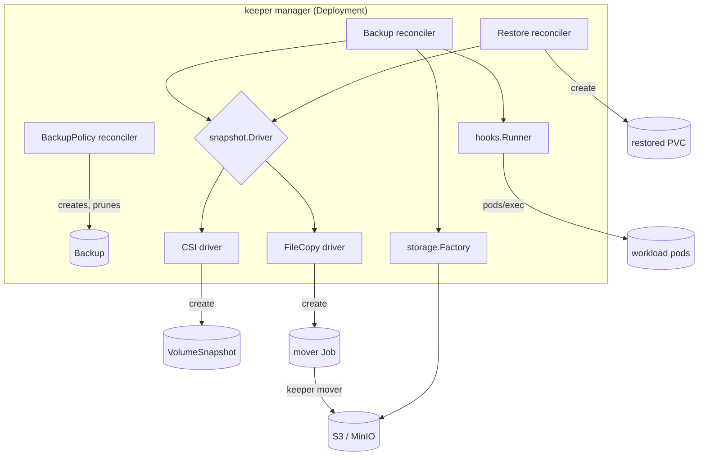
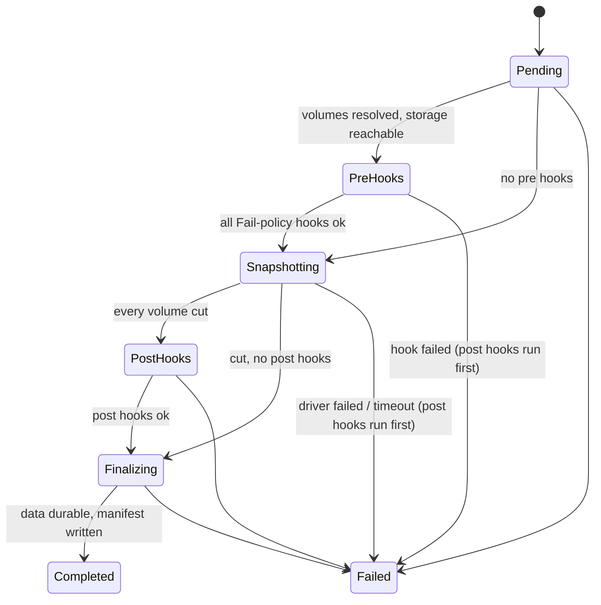

# Architecture

keeper is a controller-runtime operator with three reconcilers, two snapshot
drivers, an object-storage abstraction, a data mover and a hook runner. This
document covers how they fit together, the state machines, the key algorithms
and their complexity, and how crashes and stale caches are handled.

## Package map

| Package | Role | Depends on |
|---|---|---|
| `api/v1alpha1` | CRD types, CEL rules, well-known labels/conditions | apimachinery |
| `internal/controller` | BackupPolicy, Backup and Restore reconcilers | everything below |
| `internal/operator` | wires reconcilers + drivers into a manager (used by binary, tests, demo) | controller |
| `internal/schedule` | time-zone aware cron evaluation, bounded missed-slot search | robfig/cron |
| `internal/retention` | GFS retention engine (pure) | stdlib |
| `internal/snapshot` | `Driver` interface; `CSI` and `FileCopy` drivers | storage, mover |
| `internal/hooks` | pod selection, error policies, exec via WebSocket/SPDY | client-go |
| `internal/storage` | `ObjectStore` interface; `Memory`, `S3Store` (minio-go); key layout; secret-backed factory | minio-go |
| `internal/mover` | streaming tar.gz archive/extract with SHA-256; mover CLI contract | storage |
| `internal/metrics` | Prometheus collectors on the controller-runtime registry | prometheus |
| `internal/simcluster` | test/demo only: simulated kubelet, provisioner, snapshot controller | mover |
| `internal/storage/s3test`, `storagetest` | test only: fake S3 endpoint, store conformance suite | storage |
| `cmd/keeper` | `manager`, `mover`, `retention` subcommands | operator, mover |
| `cmd/keeper-demo` | offline end-to-end demo on envtest | operator, simcluster |



## Resources and state machines

### Backup



Each reconcile performs exactly one transition and persists it before the next
one starts. Conditions record the evidence: `PreHooksSucceeded`,
`SnapshotTaken`, `PostHooksSucceeded`, `DataStored`, `Ready`.

"Cut" and "durable" are different things. For CSI, a VolumeSnapshot is cut when
`status.creationTime` is set and durable when `readyToUse` is true. Post hooks
run at the cut, so the application is quiesced only for the cut itself and not
for the whole upload. For FileCopy the copy is cut and durable at the same
moment, when the mover Job completes, so the application stays quiesced for the
duration of the copy.

**Deletion** goes through the `backup.keeper.dev/cleanup` finalizer. If the
Backup is deleted in `PreHooks`, `Snapshotting` or `PostHooks` (any phase in
which pre hooks may have quiesced the application and post hooks have not yet
succeeded), post hooks run first and the Backup is marked `Failed`
(`DeletedInProgress`) so later finalize passes do not rerun them. `PreHooks` is
included because a deletion bumps `resourceVersion`: the freeze can have run
while its optimistic-lock status write was rejected. Deletion waits while a
non-terminal Restore reads from the Backup. With `deletionPolicy: Delete` it
then deletes driver objects (VolumeSnapshots) and every object under the
Backup's storage prefix, and only after that removes the finalizer. If storage
fails, the Backup stays and a `CleanupFailed` event is recorded. The
`skip-storage-cleanup` annotation bypasses storage.

### BackupPolicy

A policy reconcile runs the following steps in order:
1. Parse the schedule in `timeZone`. On failure set `ScheduleValid=False` and wait for a spec change.
2. List the policy's Backups (by label) and split them into active, completed and failed.
3. Apply retention to completed Backups. Annotate survivors with `retained-by`, delete the rest, and cap failed Backups at `failedBackupsHistoryLimit`.
4. Ask the schedule for the most recent slot in `(lastScheduleTime, now]`:
   - no slot or suspended → nothing;
   - later than `startingDeadlineSeconds` → skip, record the slot, emit `MissedSchedule`;
   - `Forbid` and a Backup is active → leave the slot unhandled (the Backup watch re-queues the policy when it finishes);
   - otherwise create `<policy>-<slot>`. Creation is idempotent because the name is deterministic.
5. Requeue at `min(next slot, MaxRequeue)`.

### Restore

`Pending → Restoring → Completed | Failed`. The Restore waits while its
Backup is non-terminal. It fails if the Backup failed or is being deleted
before the restore started, if a requested volume is not in the Backup, or if a
target claim already exists and was not created by this Restore. CSI restores
create claims whose `dataSource` is the VolumeSnapshot. FileCopy restores create
empty claims plus a mover Job that extracts and verifies the archive.

## Storage layout

```
<prefix>/backups/<namespace>/<backup>/backup.json            backup manifest (all drivers)
<prefix>/backups/<namespace>/<backup>/volumes/<pvc>.tar.gz   archive (FileCopy)
<prefix>/backups/<namespace>/<backup>/volumes/<pvc>.json     mover manifest: sizes, entry count, SHA-256
```

The backup manifest holds the driver, the snapshot time, per-volume records
(capacity, storage class, access modes, snapshot names or archive hashes) and
the hook results. That's enough to understand a backup from the bucket alone.

## Algorithms

### GFS retention (`internal/retention`)

Input: n items `(id, time, pinned)`, a policy `{last, hourly, daily, weekly,
monthly, yearly}`, and a time zone.

1. Sort newest-first, with ties broken by id. O(n log n).
2. `last`: mark the first `last` items.
3. For each periodic rule r with count k: walk newest-first, compute the period
   key of each item in the zone (hour, day, ISO week, month or year), and mark
   the first item seen for each new key until k distinct keys are used. The
   first item seen in a period is that period's newest. O(n) per rule using a
   hash set of keys.
4. An item is kept if any rule or the pin marks it.

Total: O(n log n + n·r) time and O(n) space. `BenchmarkApply10k` (10,000
hourly items, all six rules) measured 2.4–2.8 ms/op with 175 allocations on an
Apple M1 Pro shared with other jobs (`make bench`).

The tests check these properties with randomized policies, item sets and six
time zones (including Lord Howe's 30-minute DST and Sao Paulo's historical
fall-back across midnight):
- **oracle**: the result equals a naive "group by period, take each group's newest, rank groups, keep the first k" implementation;
- **partition and order**: every item gets exactly one verdict, and verdicts come newest-first;
- **bounds**: unpinned kept ≤ Σ counts; the newest item survives any non-empty policy;
- **idempotence**: re-applying the policy to the survivors keeps all of them, so a controller that prunes on every reconcile converges;
- **monotonicity**: raising any count never prunes something a smaller count kept;
- **bounded churn**: adding one new newest item prunes at most six previously kept items (the number of rules).

### Missed-slot search (`internal/schedule`)

`Due(since, now)` iterates `Next()` from `since` and returns the last slot ≤
now, the number of slots passed, and the next slot. The cost is
O(min(missed, 10,000)) cron evaluations, after which it returns
`ErrTooManyMissed`. A property test checks that feeding each returned slot back
as `since` visits every slot exactly once, as long as the controller wakes at
least once per slot (including `@every`, which is anchored to the previous slot).

### Data mover (`internal/mover`)

Backup is a single pass: `WalkDir` (lexical order) → tar (PAX) → gzip →
`io.MultiWriter(pipe, sha256, counter)` → `io.Pipe` → `ObjectStore.Put(size=-1)`,
which minio-go turns into a multipart upload. Memory is O(part size)
regardless of volume size. Files that shrink while being read fail the backup
(`ErrFileChanged`). Files that grow are truncated to the size recorded in their
header. Sockets, devices and FIFOs are skipped and counted, and `lost+found` at
the root is skipped.

Restore streams `Get → tee(sha256) → gunzip → untar` into a staging directory
inside the target. Each entry path must pass `SafePath` (not absolute, no `..`,
no backslash, no NUL), and no parent component may be a symlink or a file
(`checkParents`). Files are created with `O_EXCL|O_NOFOLLOW`, permissions are
masked to 0777, and hard links and device entries are skipped. Once the stream
has been read to EOF and the hash matches, entries are renamed into place, and
existing entries are never overwritten. Fuzzers (`FuzzSafePath`,
`FuzzRestore`) check that nothing is ever written outside the target.

## Consistency, caching and crash safety

- **Read-your-writes.** Reconcilers read their primary object through
  `mgr.GetAPIReader()` and write status with a merge patch carrying
  `resourceVersion` (optimistic lock). A reconcile can't act on a copy older
  than its own last write. Before this, a stale cached Backup made post hooks
  run twice, which the CSI integration test caught. A status conflict means a
  newer version exists, so the reconcile just requeues.
- **Level-triggered drivers.** `Start` creates whatever is missing and accepts
  AlreadyExists only for objects carrying the Backup's label. `Observe` only
  reads. NotFound right after Start is treated as cache lag ("pending"), not
  failure. Volumes already recorded as ready are not re-read, so a
  TTL-collected mover Job does not matter.
- **Crash at each step:**

| Crash after | On restart | Effect |
|---|---|---|
| Backup created, before Pending persisted | starts again from Pending | none |
| pre hooks ran, before PreHooks→Snapshotting persisted | pre hooks run again | hooks must be idempotent (at-least-once) |
| VolumeSnapshot / Job created, before status persisted | `Start` finds them (AlreadyExists, label matches) | none |
| cut observed, before PostHooks persisted | Observe sees the cut again | none |
| post hooks ran, before Finalizing persisted | post hooks run again | at-least-once |
| manifest written, before Completed persisted | manifest rewritten with the same content | none |
| policy created Backup, before lastScheduleTime persisted | same deterministic name → AlreadyExists | none |
| finalizer cleanup half done | DeletePrefix lists what is left and continues | none |
| deleted in PreHooks/Snapshotting/PostHooks, before `DeletedInProgress` persisted | post hooks run again | at-least-once |

## Security notes

- Credentials live only in a Secret. Mover Jobs get them through `secretKeyRef`,
  so they never appear in the Job spec, and the manager reads the Secret only
  to build an S3 client.
- Mover pods run with `automountServiceAccountToken: false`, a read-only root
  filesystem, no privilege escalation, a RuntimeDefault seccomp profile, and
  every capability dropped except the minimum for the direction (see
  DECISIONS.md). Backup mounts are read-only.
- An empty hook `podSelector` matches nothing, never every pod in the
  namespace. Hook commands run without a shell unless the user asks for one.
- The manager needs `pods/exec` cluster-wide. That's a powerful permission:
  anyone who can create a Backup in a namespace can make the operator exec
  commands in pods there. Treat create rights on Backup and BackupPolicy like
  `pods/exec` rights when designing RBAC. This is listed under Limitations.
- Restore extraction is hardened against path traversal, symlink planting and
  setuid bits, and runs in a staging directory with a checksum gate.

## Testing strategy

| Layer | What | Where |
|---|---|---|
| Pure logic | retention (table, oracle + 5 properties, benchmark), schedule (table, property) | `internal/retention`, `internal/schedule` |
| Data path | archive round trip, determinism, hostile archives, checksum gate, two fuzzers | `internal/mover` |
| Storage | one conformance suite run against `Memory`, minio-go → fake S3 (incl. multipart), and real MinIO (`make integration`) | `internal/storage` |
| Hooks | selection, error policies, truncation, exec URL, transport errors | `internal/hooks` |
| API | every CEL/OpenAPI rule, defaults, immutability, samples server-side dry-run | `internal/controller` (envtest) |
| Lifecycle | FileCopy and CSI backup/restore, hook ordering, failure modes, finalizer paths, scheduling, Forbid/suspend, deadlines, 30-slot GFS convergence | `internal/controller` (envtest + simcluster) |
